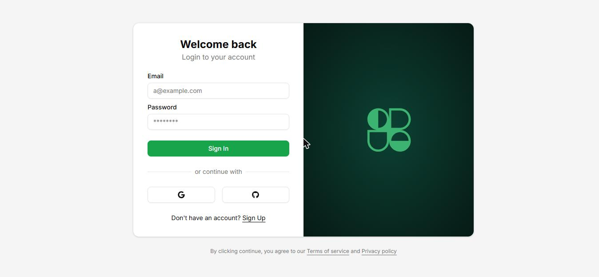
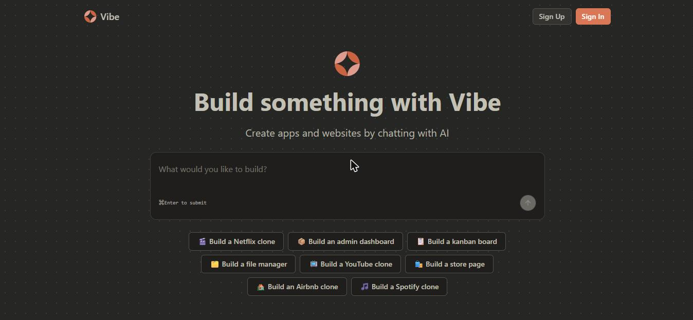
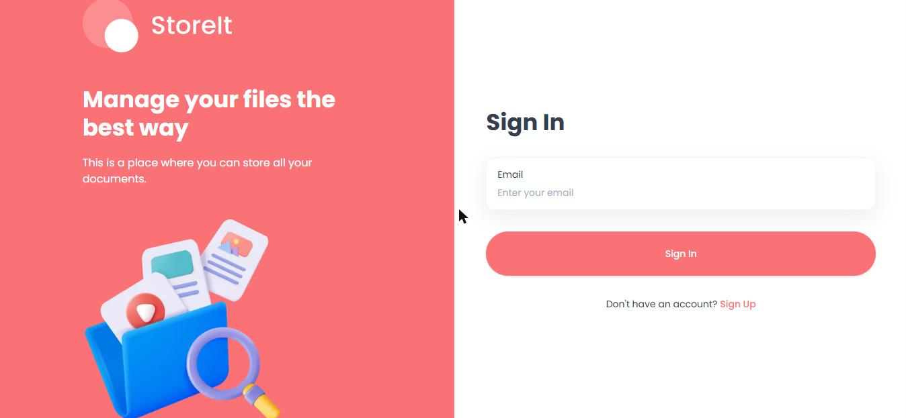

# Rakesh Choudhary

**Full-stack developer, Mumbai.** I build web apps with React, Next.js and Node.js, and I like the parts of the stack where LLMs meet real engineering: background jobs, realtime voice, sandboxed code execution.

B.E. Computer Science, RGIT Mumbai (2026). Looking for a junior full-stack or frontend role, Mumbai or remote, available immediately.

[Portfolio](https://rakesh-portfolio-qp81.vercel.app) · [LinkedIn](https://linkedin.com/in/rakesh-choudhary-540256261) · [Email](mailto:rakeshchoudhary8779@gmail.com)

---

## Selected work

<table>
<tr>
<td width="46%" valign="top"></td>
<td valign="top">
<h3><a href="https://github.com/Rakesh-27-git/Buddy-AI">Buddy AI</a></h3>
Video meetings where a custom AI agent joins the call over OpenAI's realtime API. Stream webhooks drive the meeting lifecycle (upcoming, active, processing, completed), and an Inngest job turns the transcript into a summary.
  
Next.js · tRPC · Drizzle + Postgres · better-auth · Stream Video · OpenAI Realtime · Inngest
  
<a href="https://buddy-ai-eight.vercel.app">Live demo</a> · <a href="https://github.com/Rakesh-27-git/Buddy-AI">Source</a>
</td>
</tr>
<tr>
<td width="46%" valign="top"></td>
<td valign="top">
<h3><a href="https://github.com/Rakesh-27-git/vibe">Vibe</a></h3>
Describe an app in chat and an agent network writes the code, runs it in an E2B sandbox and returns a live preview. Generation runs as a durable Inngest job, and usage is credit-limited per user and plan.
  
Next.js · tRPC · Prisma + Postgres · Inngest agent-kit · E2B · Clerk
  
<a href="https://vibe-phi-weld.vercel.app">Live demo</a> · <a href="https://github.com/Rakesh-27-git/vibe">Source</a>
</td>
</tr>
<tr>
<td width="46%" valign="top"></td>
<td valign="top">
<h3><a href="https://github.com/Rakesh-27-git/Store_It">StoreIt</a></h3>
File storage with email one-time-password sign-in, uploads up to 50 MB, sharing, search, sorting and a storage-usage chart. Next.js server actions on top of Appwrite.
  
Next.js · Appwrite · Tailwind · React Hook Form + Zod · Recharts
  
<a href="https://store-it-tan.vercel.app">Live demo</a> · <a href="https://github.com/Rakesh-27-git/Store_It">Source</a>
</td>
</tr>
</table>

---

## Stack

<table>
<tr>
<td width="150"><b>Languages</b></td>
<td></td>
</tr>
<tr>
<td><b>Frontend</b></td>
<td> &nbsp;Radix UI · shadcn/ui · TanStack Query · React Hook Form + Zod</td>
</tr>
<tr>
<td><b>Backend</b></td>
<td> &nbsp;tRPC · REST APIs · BullMQ · rate limiting</td>
</tr>
<tr>
<td><b>Data</b></td>
<td> &nbsp;Drizzle ORM · Appwrite</td>
</tr>
<tr>
<td><b>AI and realtime</b></td>
<td>LiveKit (WebRTC / SIP) · OpenAI APIs and Realtime · Inngest agent-kit · E2B sandboxes · Stream Video · streaming TTS</td>
</tr>
<tr>
<td><b>Tooling</b></td>
<td></td>
</tr>
</table>

---

## Experience

**Software Engineer, Arham Fintech** · Aug 2026 – Nov 2026 · Mumbai
- Built the real-time voice pipeline for Flow Orbit with Python, LiveKit (WebRTC/SIP) and Sarvam AI, so AI voice agents can handle customer support calls in 11+ Indic languages.
- Cut voice reply latency from 1.8s to about 1.0s by streaming speech synthesis, pre-warming connections and handling user interruptions (barge-in).
- Built full-stack modules for an enterprise HRMS platform (role-based auth, employee management, travel and expense tracking) with React, Node.js and PostgreSQL, used by 700+ employees across 6 companies.
- Secured HRMS auth routes with Redis rate limiting and queued background emails with BullMQ.

**Full Stack Developer Intern, Beldara** · Feb 2025 – Aug 2025 · Mumbai
- Shipped full-stack features with React, Node.js and Express for a 10-minute grocery delivery app on the Play Store (10K+ downloads).
- Built paginated product listings and added 300ms search debouncing to avoid redundant API calls.
- Designed and maintained REST APIs for catalog, cart and checkout, coordinating with mobile developers to keep endpoints consistent across web and app.

## Education

**B.E. Computer Science and Engineering**, Rajiv Gandhi Institute of Technology, Mumbai · 2022 – 2026
