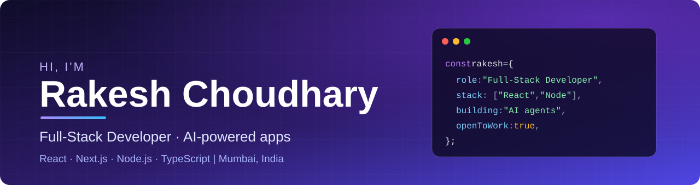
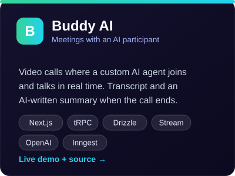
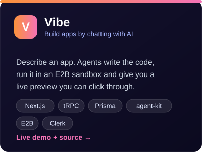
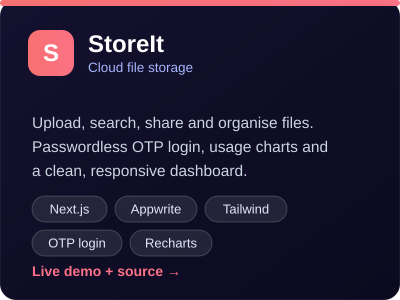

  
  
  

  
  
  

## About

I'm a full-stack developer from Mumbai. I build web apps with **React, Next.js and Node**, and I'm most interested in products that put **LLMs and agents to real use**: background jobs, realtime voice, sandboxed code execution.

B.E. Computer Science, RGIT Mumbai (2026). Previously a Full Stack Developer intern at **Beldara**, working on a quick-commerce app with 10K+ Play Store downloads.

## Featured projects

  
  
  

  <b>Buddy AI</b> · <a href="https://buddy-ai-eight.vercel.app">live</a> &nbsp;|&nbsp;
  <b>Vibe</b> · <a href="https://vibe-phi-weld.vercel.app">live</a> &nbsp;|&nbsp;
  <b>StoreIt</b> · <a href="https://store-it-tan.vercel.app">live</a>

## Tech I work with

  

  tRPC · Drizzle · Zod · TanStack Query · Inngest · Appwrite

## Most used languages

  

---

Looking for a junior full-stack or frontend role. Reach me on <a href="mailto:rakeshchoudhary8779@gmail.com">email</a> or <a href="https://linkedin.com/in/rakesh-choudhary-540256261">LinkedIn</a>.

